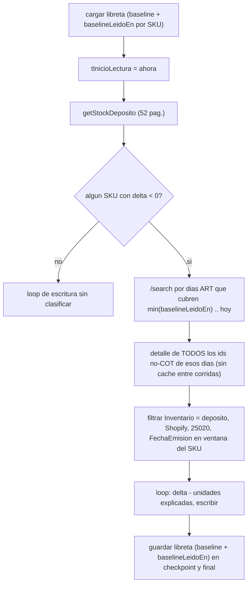
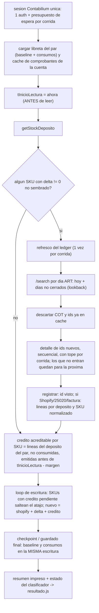
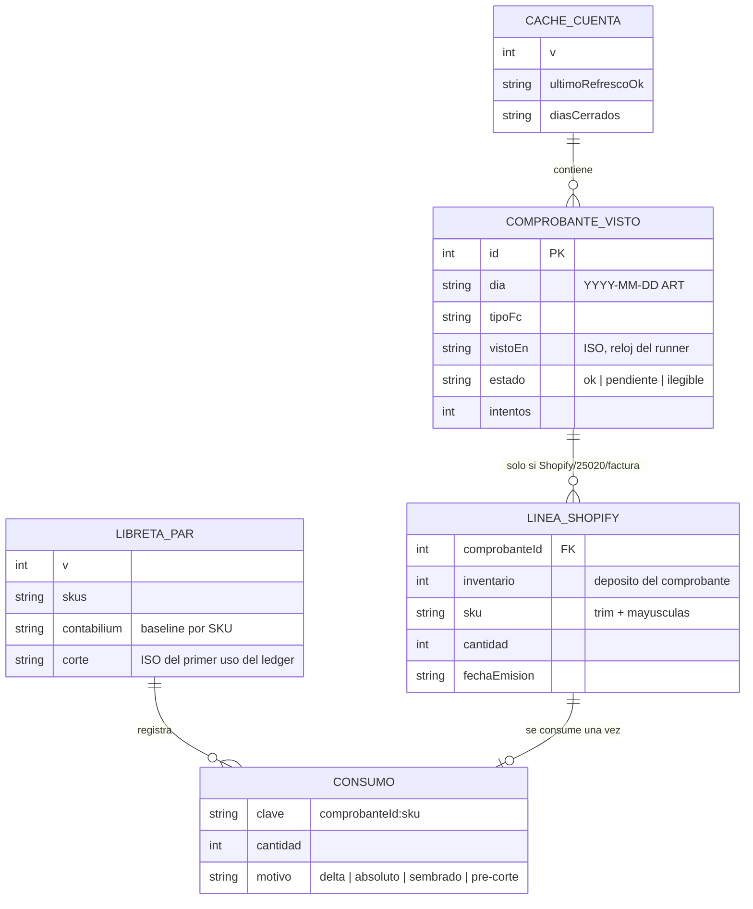

# Rediseño del clasificador de causa por comprobante (2026-11-02)

Análisis de arquitectura tras el **segundo rechazo** del juez independiente sobre
`clasificador-causa-comprobante`. Esto **no** es implementación: no toca `src/`, `test/` ni
`.agents/.arn/feature.md`. La persona elige alternativa y decisiones (sección 6) antes de que se
implemente nada.

Fuentes leídas: `docs/contratos/clasificador-causa-comprobante.md` (contrato original, R-1..R-10),
`.agents/.arn/feature.md` (contrato reabierto, subset R-1/R-3/R-5/R-6/R-9),
`docs/adr/0001-semantica-de-escritura-de-stock.md`, `AGENTS.md`, `src/sync.js`, `src/contabilium.js`,
`src/clasificador-causa.js`, `src/resultado.js`, `src/index.js`, `.github/workflows/sync.yml`, y la
evidencia `iey-ai/docs/specs/dot-stock-sync/evidence/p0-s2-comprobantes.md` (en adelante **P0-S2**).

Separación que se respeta en todo el documento: **[H]** hecho verificado con cita, **[S]** supuesto
no verificado, **[D]** decisión que tiene que tomar la persona.

---

## 1. Entendimiento del problema de fondo

**Qué tiene que hacer el clasificador** (ADR 0001:20-22, 30-33): cuando Contabilium baja el stock
del DOT, distinguir la unidad que **ya** descontó Shopify (una venta de Shopify facturada a mano
contra el DOT: `Origen="Shopify" ∧ IDIntegracion=25020 ∧ Inventario=127356`, P0-S2:136-139) de la
que no (mostrador, otra causa). La primera no se vuelve a descontar; la segunda sí.

**El supuesto común.** El diseño actual asume que *"el comprobante que explica una baja vive en una
ventana temporal fina, `[última corrida exitosa del par, ahora]`, que se puede expresar en la
consulta a la API y alinear con un único timestamp por par"*. Cuatro hallazgos son ese mismo
supuesto roto por lados distintos:

| hallazgo | qué parte del supuesto se rompe |
|---|---|
| 1 (formato de fecha) | la API probada solo acepta `YYYY-MM-DD` (`iey-ai/src/app/api/cron/sync-sales/route.ts:32-46,106-111`, `iey-ai/.../client.ts:838-853`); la ventana fina **no se puede expresar** en la consulta |
| 5 (timestamp tardío) | el borde de la ventana no coincide con el momento de la lectura: `timestampLecturaStock` se toma en `src/sync.js:523`, **después** del `await deps.getStockDeposito` de `src/sync.js:516` |
| 6 (ventana por par) | la ventana es por par (`src/sync.js:636` usa `libreta.ultimaCorridaExitosa`, que avanza en `src/sync.js:709-711` aunque haya SKUs en `error`/`ambiguo`), pero el baseline es por SKU (`src/sync.js:692-694`); para un SKU retrasado la ventana ya no cubre su intervalo |
| 7 (checkpoint) | el checkpoint avanza baselines (`src/sync.js:700-702`) pero no la ventana; y la ventana no tiene memoria de qué comprobante ya se usó |

**Qué cambia si la API solo granula por día.** La ventana deja de discriminar: cada corrida con un
delta negativo ve **todos** los comprobantes de la cuenta del día (0 a ~149; P0-S2:14-15 da 8.922
en 60 días). Con eso:

- el emparejamiento temporal desaparece en la práctica (el mismo comprobante de las 10:00 es
  candidato en todas las corridas hasta medianoche), así que **lo único que evita el doble uso es
  recordar qué comprobante ya se usó**: eso es estado persistente, no una ventana;
- el costo pasa a escalar con *corridas × comprobantes del día* en vez de con *comprobantes nuevos*,
  porque sin caché persistente cada corrida vuelve a pedir el detalle de todo el día.

Conclusión: los hallazgos 1, 5, 6 y 7 no se arreglan bien uno por uno. Se arreglan cambiando el
modelo de **"ventana temporal"** a **"contabilidad de comprobantes"**: cada comprobante se lee una
vez, se registra, y sus unidades se acreditan una sola vez contra el SKU que afectan.

Hechos adicionales que aparecieron al leer el código (no estaban en la lista del juez):

- **[H]** El camino de producción (`correrTodosLosPares` → `ejecutarPar`) **no imprime ningún
  resumen**: `ejecutarPar` devuelve los contadores (`src/sync.js:713`) y `src/index.js:155-163` solo
  imprime fallos. El bloque `--- Resumen ---` existe únicamente en el `syncTodos` legado
  (`src/sync.js:441-451`). Agrava el hallazgo 4: hoy no hay forma de ver `causa_*` ni siquiera
  cuando el clasificador funciona.
- **[H]** El clasificador solo corre en deltas **negativos** (`src/sync.js:630`). Si en el mismo
  intervalo hay una venta Shopify facturada contra el DOT (−1) y una reposición (+5), el delta neto
  es +4: no se clasifica, se aplica +4 sobre un Shopify que ya había descontado la unidad, y el
  resultado queda 1 abajo. Mismo daño que el censo de agosto, por otra puerta. Ver decisión D-3.
- **[H]** Un fallo en el detalle de **un** comprobante tira el lote entero: `fetchComprobantesDetalle`
  propaga la excepción (`src/contabilium.js:399-402`) y el `catch` de `src/sync.js:564-566` marca
  toda la corrida como `fallo`. P0-S2:212-213 registra un comprobante (`Id=173386407`, `NCA`) que
  falló el parseo estricto: un caso así dejaría al clasificador ciego todo el día.
- **[H]** Las cotizaciones (`COT`) no mueven stock (P0-S2:15) y `/search` ya trae `TipoFc` por ítem
  (`iey-ai/.../client.ts:455-466`): se pueden descartar **antes** de pedir el detalle.
- **[H]** El ritmo del cliente es 500 ms entre pedidos (`src/contabilium.js:17`), o sea 20 req/10 s.
  `iey-ai` presupuesta 18/25 (`AGENTS.md`, Límites externos). Si ambos coinciden, 38 > 25. Para
  `/api/inventarios` el cliente de `iey-ai` documenta un límite propio de 30/10 s
  (`iey-ai/.../client.ts:884-885`); para comprobantes no hay límite propio documentado, así que
  vale el general de 25/10 s.

---

## 2. Alternativas

### Alternativa A — Mantener la ventana temporal y parchear

**Cambios:** (a) `buscarComprobantes` recibe días `YYYY-MM-DD` calculados en
`America/Argentina/Buenos_Aires`, como `iey-ai` (`route.ts:32-46`); (b) `tInicioLectura` se toma
**antes** de `getStockDeposito`; (c) ventana **por SKU**: la libreta guarda `baselineLeidoEn[sku]`
junto con `contabilium[sku]`, y un comprobante explica la baja de un SKU solo si su `FechaEmision`
(del detalle, `iey-ai/.../client.ts:503-504`) cae en `[baselineLeidoEn[sku], tInicioLectura)`;
(d) filtro por `Inventario` y `TipoFc` **antes** de contar candidatos; (e) sesión única y
presupuesto por corrida; (f) falla visible; (g) argv estricto.



**Lo que A no resuelve, dicho de frente:**

- **Costo, si la API granula por día.** Sin caché entre corridas, cada corrida con un delta
  negativo vuelve a pedir el detalle de todos los comprobantes del día: 0 a ~149 GET, 75 s por
  corrida a 500 ms y ~225 s si se baja el ritmo a 1,5 s para respetar el cupo compartido. Son las
  1.500-2.300 GET/día que calculó el juez. Un SKU retrasado varios días (`error` persistente que
  después se resuelve) ensancha su ventana a varios días y multiplica eso.
- **Depende de `FechaEmision` con hora y zona correctas.** No está verificado en qué zona viene ni
  si es la hora real de alta (hueco H-4). Si se interpreta 3 h corrida, se acreditan comprobantes
  cuyo efecto todavía no llegó al stock: Shopify queda arriba, con riesgo de sobreventa.
- **Doble uso: lo resuelve solo a medias.** Con ventana por SKU, un comprobante cae en un único
  intervalo, así que no explica dos bajas del mismo SKU. Pero un comprobante emitido **durante** la
  lectura cuyo efecto ya entró en esta lectura se asigna al intervalo siguiente; si en el siguiente
  el SKU no tiene delta, el atajo incremental (`src/sync.js:578`) lo saltea y ese crédito se pierde:
  queda un doble descuento permanente. Taparlo exige recordar créditos pendientes, que es estado
  persistente, o sea B.
- **Deltas no negativos** (hecho adicional de la sección 1): A los sigue sin ver salvo que se
  amplíe el disparo, lo que agrava el costo.

### Alternativa B — Registro persistente de comprobantes (ledger)

**Idea:** pasar de *"qué comprobante cae en esta ventana"* a *"qué unidades Shopify-DOT ya
facturadas todavía no se acreditaron"*. Es la contabilidad que pide el ADR: "la reconciliación
necesita `base_contabilium` **y** `shopify_esperado`" y "journal `pendiente`/`confirmado`"
(ADR 0001:39-43).

**Regla contable.** Para cada SKU del par:

```
shopify_esperado = shopifyActual + (contabiliumActual - baseline) + creditoAcreditable(sku)
```

`creditoAcreditable(sku)` es la suma de las cantidades de líneas Shopify-DOT del SKU que todavía no
se consumieron y que son **acreditables** en esta corrida: comprobante emitido antes de
`tInicioLectura - margen` (o visto por primera vez en una corrida anterior; ver H-4). Al aplicarse,
esas líneas se marcan consumidas **en la misma escritura de la libreta que avanza el baseline**.

Por qué es correcta en todos los órdenes de eventos:

| caso | resultado |
|---|---|
| censo de agosto: venta Shopify facturada a mano contra el DOT, delta −1 | crédito 1, `shopify + (−1) + 1 = shopify`: no se vuelve a descontar (R-5) |
| delta −3 = 1 Shopify-DOT + 2 mostrador | crédito 1, se escribe −2: exacto, sin "todo o nada" (I-1) |
| venta Shopify-DOT −1 + reposición +5 en el mismo intervalo | delta +4, crédito 1, se escribe +5: correcto (A y el código actual escriben +4) |
| dos comprobantes del mismo SKU en el intervalo | se suman: no hay "más de un candidato → desconocida" |
| comprobante emitido durante la lectura | no es acreditable todavía: se acredita en la corrida siguiente. Ventana transitoria de 1 corrida con Shopify 1 abajo (el lado seguro: subventa, no sobreventa) |
| comprobante que se ve tarde (falló el refresco) | el delta se aplicó sin crédito (doble descuento transitorio); en cuanto aparece, el crédito pendiente fuerza al SKU a saltear el atajo incremental y se repone: se autocorrige |
| SKU en `error`/`ambiguo` | ni baseline ni consumo avanzan; el crédito sigue pendiente para el reintento (hallazgo 6) |
| interrupción entre checkpoints | baseline y consumo se escriben juntos; lo no alcanzado no tiene ninguno de los dos (hallazgo 7) |
| un comprobante usado | marcado consumido: no puede explicar otra baja (hallazgo 7, segunda parte) |



Modelo de datos (ER):



**Dónde se persiste.** Dos archivos dentro de `.cache/`, que ya viaja con `actions/cache`
(`.github/workflows/sync.yml:68-74` y `:130-135`, este último con `if: always()`):

1. **Caché de comprobantes de la cuenta**, `.cache/comprobantes.json`, compartido entre pares
   (un comprobante es de la cuenta, no del par). Solo afecta el **costo**: si se pierde, se vuelve a
   pedir. Se puede guardar también en `DRY_RUN` (es dato de solo lectura).
2. **Consumos**, **dentro de la libreta del par** (`last-sync.<stateKey>.json`,
   `src/sync.js:147-149`), en el mismo `payload` que escribe `guardarSnapshot`
   (`src/sync.js:118-132`). Esto afecta la **corrección**: baseline y consumo tienen que avanzar en
   la misma escritura. Si fueran archivos separados, un corte entre las dos escrituras deja un
   baseline avanzado con un crédito sin marcar (se reutiliza, Shopify queda arriba: sobreventa) o al
   revés. En `DRY_RUN` no se guarda, igual que el baseline (`src/sync.js:700,709`).

   Mejora recomendada al pasar: escribir a `*.tmp` y `rename` para que un corte a mitad de
   `writeFileSync` no deje un JSON truncado (hoy `cargarLibretaCompleta` lo trata como libreta vacía,
   `src/sync.js:93-99`, lo que dispara un resembrado absoluto).

**Tamaño y poda.** ~149 comprobantes/día en la cuenta (P0-S2:14). Registro mínimo para los no
relevantes (`id`, `dia`, `tipoFc`, `estado`): ~40 B. Retención de 7 días: ~1.050 entradas, ~40 KB.
Las líneas Shopify-DOT son raras (1/36 en junio-julio, 3/6 en el censo de agosto; P0-S2:123-126) y
se guardan hasta que se consumen o hasta 30 días (D-6); al vencer sin consumirse, se cuentan en el
resumen como `credito_vencido`. Los consumos de la libreta se podan cuando su comprobante sale de la
caché.

**Consulta por día y lookback.** `fechaDesde`/`fechaHasta` en `YYYY-MM-DD` de Argentina (mismo
formateador que `iey-ai`, `route.ts:33-38`). Propuesta:

- **Régimen normal: hoy, más el día anterior una sola vez después de medianoche.** El día D se
  vuelve a consultar en el primer refresco de D+1 y queda en `diasCerrados`. Cubre comprobantes de
  las 23:5x que la última corrida de D no vio. En régimen: ≤ 3 páginas por refresco.
- **Hueco detectado:** si `ultimoRefrescoOk` es más viejo que ayer, el lookback se extiende hasta
  ese día, con **tope de 7 días** (coincide con el vencimiento de `actions/cache`: más atrás no hay
  libreta que proteger). Los detalles pendientes se reparten entre corridas con el tope por corrida.
- **Por qué no menos:** hoy-solo pierde el borde de medianoche. **Por qué no más en régimen:** cada
  día extra cuesta ~3 páginas por refresco. Un comprobante con `FechaEmision` retroactiva más vieja
  que lo ya cerrado no se vería (hueco H-3).

**Primera corrida tras el deploy.** No hay caché. Se fija `corte = tInicioLectura` de esa corrida en
la libreta del par. El refresco trae hoy y ayer (≤ ~300 ids, repartidos con el tope por corrida).
Las líneas Shopify-DOT con `FechaEmision < corte` se registran como **consumidas `pre-corte`**: su
efecto ya pasó por el sync viejo y no se sabe si se descontó dos veces. Acreditarlas a ciegas puede
inflar Shopify. Se informa su cantidad agregada en el resumen para revisión humana (la reparación es
la compuerta manual, R-7).

**Si se pierde el caché.** `actions/cache` vence a los 7 días sin uso y la libreta viaja en el mismo
directorio. Si se pierden las dos, hoy cada SKU queda `sembrado` y se escribe el absoluto
(`src/sync.js:206-209`): eso ya pasa hoy, no lo introduce B. Con B, el corte se reinicia y vale la
regla de la primera corrida. Si se pierde solo la caché de comprobantes y la libreta sobrevive
(archivo corrupto), se repiden hoy y ayer. Las líneas no consumidas más viejas se pierden: su
doble descuento queda (subventa, lado seguro) y lo detecta la reconciliación.

**Checkpoints e interrupciones.** El checkpoint (`src/sync.js:700-702`) pasa a escribir baseline y
consumos juntos. Un SKU no alcanzado no tiene ninguno de los dos. Como ya no hay ventana por par, no
hay solapamiento. `ultimaCorridaExitosa` deja de usarse para la ventana; puede quedar solo como dato
de observabilidad (D-7).

**`--full` (R-10).** El costo de B depende del volumen de la cuenta y no del número de SKUs ni de la
antigüedad de la última corrida, así que el motivo de R-10 ("la ventana podría ser de días") ya no
aplica. Recomendación: que el clasificador **corra** en `--full` con el mismo refresco único (D-4).
Si la persona prefiere no tocar R-10, B funciona igual con el clasificador apagado en `--full`, pero
**los créditos no se consumen** en esa corrida (quedan para la siguiente incremental) en vez de
perderse como `causa_desconocida`.

**Compuerta manual (R-7).** Para un SKU alcanzado por `escritura_absoluta`: se escribe el absoluto,
se resiembra el baseline y **todas sus líneas acreditables a esa hora se marcan consumidas
`absoluto`**. El absoluto ya incorpora su efecto: acreditarlas después inflaría Shopify. Lo mismo
para un SKU `sembrado`. Las líneas emitidas después de `tInicioLectura` siguen pendientes.

**Costo real.** Supuestos: ~149 comprobantes/día en la cuenta, ~142 sin COT (8.508/60, P0-S2:15),
50 por página. La cadencia real de corridas no es conocida (hueco H-6), así que se parametriza con
`N` = corridas por día con algún delta ≠ 0 en el DOT.

| | por refresco (régimen) | peor corrida | por día |
|---|---|---|---|
| A, si la API granula por día | 1-3 `/search` + 0-149 detalles | ~152 GET (75 s a 500 ms; ~225 s a 1,5 s) | ≈ N × 75 (el juez estimó 1.500-2.300) |
| **B** | ≤ 3 `/search` + ids nuevos desde el último refresco (en régimen, pocos) | 3-6 `/search` + tope de detalles (propuesto 60) ≈ 66 GET, ~100 s a 1,5 s; solo tras un hueco o el primer deploy | ≈ 3N + ~142 (cada id una vez en su vida). Con N=30: ~232 GET/día |
| existente (no cambia) | | 1 auth + ~52 páginas de stock | |

Ritmo propuesto para comprobantes: **≥ 1,5 s entre pedidos** (≤ 6,7 req/10 s, dentro de los 7/10 s
que deja `iey-ai`), configurable. Hoy es 500 ms (`src/contabilium.js:17`). La auth pasa de 3 por
corrida (`src/contabilium.js:215,330,396`) a 1.

### Alternativa C — Consumir comprobantes desde `iey-ai` (o desde el `BrokerContabilium`)

`iey-ai` ya ingiere comprobantes con detalle (`fetchComprobanteById` con `expectedDocumentType`,
`iey-ai/.../client.ts:863-876`) para su sync de ventas. shopify-sync podría leer de ahí y gastar
**cero** cupo extra de Contabilium.

- **A favor:** el mejor costo posible, y una sola fuente de lectura para los dos consumidores.
- **En contra:** acopla este repo público a la base o la API de `iey-ai` (credenciales nuevas en
  GitHub Actions, superficie de seguridad); la frescura queda atada al cron de `iey-ai`; `AGENTS.md`
  pone fuera de alcance tocar el sync de ventas de `iey-ai`; el `BrokerContabilium` está "bloqueado
  en ese otro repo" (`docs/contratos/clasificador-causa-comprobante.md:339`). Es una fase 2
  razonable, **no** una alternativa ejecutable hoy.
- Incluso así, haría falta la contabilidad de consumos de B. C cambia solo **de dónde** vienen los
  comprobantes, no **cómo** se usan.

### Tabla de cobertura de hallazgos

| # | hallazgo | A (parches) | B (ledger) | C (vía iey-ai) |
|---|---|---|---|---|
| 1 | formato de fecha / costo por día | formato sí; costo **no** (re-pide el día en cada corrida) | formato sí; costo acotado (cada id una vez; ≤ 3 páginas por refresco) | no pega a `/search`; depende de `iey-ai` |
| 2 | filtro por depósito | sí (filtrar `Inventario` antes de contar) | sí; además no cuenta candidatos: suma unidades | sí, igual que B |
| 3 | reintentos por id / 3 auth | sí (sesión única, transversal) | sí (transversal) | no aplica a comprobantes; sigue aplicando al stock |
| 4 | falla silenciosa | sí (transversal) | sí (transversal) | sí (transversal) |
| 5 | timestamp tardío | sí (`tInicioLectura` antes de leer) | sí, más margen; lo emitido durante la lectura se difiere sin perderse | igual que B |
| 6 | ventana por par vs baseline por SKU | sí, con `baselineLeidoEn` por SKU | sí, sin ventana: crédito pendiente por SKU | igual que B |
| 7 | checkpoint / doble uso | parcial: no hay doble uso dentro de un intervalo, pero se pierden créditos diferidos | sí: consumo atómico con el baseline | igual que B |
| 8 | inyección por argv | sí (transversal) | sí (transversal) | sí (transversal) |
| 9 | contrato completo | sí (sección 5) | sí (sección 5) | sí |
| 10 | notas menores | sí (transversal) | sí (transversal) | sí |
| extra | delta neto ≥ 0 con venta Shopify-DOT oculta | no, salvo ampliar el disparo (más costo) | sí (crédito con cualquier signo; D-3) | igual que B |
| extra | un detalle que falla tira el lote | sí, si se adopta el estado por id | sí: estado `pendiente`/`ilegible` por id | depende |

---

## 3. Recomendación

**B, ledger persistente con contabilidad de créditos.** Motivos:

1. **Es la única que cierra los hallazgos 1, 5, 6 y 7 por construcción** y no por cuatro parches.
   No depende de que la API filtre por hora, que es justamente lo que nadie pudo verificar.
2. **El costo escala con el volumen de la cuenta** (~142 detalles/día, cada uno una vez) y no con
   corridas × día. Es lo único compatible con el cupo compartido de 25/10 s si la API granula por
   día, que es el caso más probable según el único uso probado (`route.ts:106-111`).
3. **Falla hacia el lado seguro.** Ante datos tardíos o faltantes, el error transitorio es un doble
   descuento (Shopify abajo: subventa) que se autocorrige cuando aparece el comprobante. No es un
   crédito de más (Shopify arriba: sobreventa), que es el daño que el invariante 1 de `AGENTS.md`
   prohíbe.
4. **Es lo que el ADR ya pedía:** `shopify_esperado` más un journal `pendiente`/`confirmado`
   (ADR 0001:39-43).
5. **C no es ejecutable hoy** y de todos modos necesitaría la contabilidad de B.

Costo de B que la persona tiene que aceptar: un esquema persistente nuevo (caché de cuenta + consumos
en la libreta), una regla de corte para el primer deploy y más superficie de tests. Es reversible:
borrar `.cache/comprobantes.json` y los consumos devuelve el sistema al delta puro (el
comportamiento de R-4).

---

## 4. Requisitos transversales (valen para cualquier alternativa)

### 4.1 Hallazgo 4: prohibido fallar en silencio

**Qué se loguea.** El `catch {}` de `src/sync.js:564` pasa a capturar el error y loguear
`[CLASIFICADOR][ERROR] <par>: <err.message>` una vez por corrida. El mensaje ya viene acotado a
200 caracteres del cuerpo y no contiene secretos (`src/contabilium.js:316-318,379`). Ningún log por
SKU para `causa_desconocida` (ADR 0001:45-46). Los detalles que fallan se cuentan, no se listan.

**Qué se suma al resumen.** `ejecutarPar` imprime un resumen por par (hoy no imprime ninguno; ver
sección 1) con los contadores existentes más: `clasificador` = `no_requerido | ok | parcial | fallo`,
`causa_venta_shopify` (unidades acreditadas), `causa_desconocida` (SKUs con delta aplicado sin
crédito), `creditos_pendientes`, `creditos_pre_corte`, `creditos_vencidos`, `comprobantes_pedidos`
(search + detalle), `comprobantes_pendientes` (los que quedaron por tope o error).

**Qué evalúa `resultado.js`.** `evaluarCorrida` (`src/resultado.js:18-62`) hoy no mira nada del
clasificador. Se agrega una regla después del chequeo de efectivos: si
`resumen.clasificador === "fallo"`, entonces `ok: false` con un motivo propio.

**¿Advertir o hacer fallar?** Recomendación: **hacer fallar la corrida (exit 1) cuando el
clasificador era necesario y falló, después de aplicar todas las escrituras.**

- El invariante 5 de `AGENTS.md` nombra el modo de falla real: "el tilde verde vacío". Un
  clasificador roto en el 100 % de las corridas con exit 0 es exactamente eso: la defensa
  obligatoria del ADR está apagada y nadie se entera. Una advertencia (`::warning::`) en un workflow
  disparado cada minuto no la lee nadie: H3 tuvo 2.396 errores en verde.
- R-4 ("no bloquea") se sigue cumpliendo: los deltas se aplican igual y la libreta se guarda antes
  de salir. Lo que cambia es el color de la corrida, no lo que escribe.
- `no_requerido` (sin deltas) y `parcial` (quedaron ids para la próxima por el tope) **no** fallan:
  no son fallas.
- **Alternativa para la persona (D-5):** fallar recién tras K corridas consecutivas con `fallo`
  (contador persistido en la libreta), para no poner en rojo una corrida por un 429 aislado. Con B
  un fallo aislado no pierde datos (el refresco siguiente recupera), así que K=3 es defendible. Con
  A no lo es.

### 4.2 Hallazgo 3: una sesión y un presupuesto por corrida

- Un objeto `sesion = { token, estado: { esperaAcumuladaMs, ultimoError } }` creado **una vez** por
  corrida y pasado a `getStockDeposito`, `buscarComprobantes` y `fetchComprobantesDetalle`. Hoy cada
  uno autentica por su cuenta (`src/contabilium.js:215,330,396`) y `fetchComprobanteById` arma un
  `estado` nuevo por id (`src/contabilium.js:358`), así que el techo de
  `PRESUPUESTO_ESPERA_MS` (`src/contabilium.js:41`) vale por id y no por corrida.
- Un solo techo de espera de 5 min para toda la corrida. Si el clasificador lo agota, corta
  (`clasificador=fallo` o `parcial`) y **no** sigue gastando cupo.
- Sub-presupuesto del clasificador: un tope de detalles por corrida (propuesto 60) y un ritmo propio
  (≥ 1,5 s).
- `fetchComprobanteById` deja de ser exportado como dependencia standalone: sale de `DEPS_REALES`
  (`src/sync.js:487`) y del import (`src/sync.js:17`). Queda como helper interno de
  `fetchComprobantesDetalle`.
- Un id que falla no tira el lote: se marca `pendiente` con `intentos++`; a los 3 intentos con error
  no transitorio (400/404 o contrato) pasa a `ilegible` y se cuenta.

### 4.3 Hallazgo 8: inyección por argv

**Hecho.** `src/index.js:29-31` hace `args.includes("--cron"|"--full"|"--locations")` sobre todo el
argv, y el workflow pasa `--escritura-absoluta "$ESCRITURA_ABSOLUTA" --motivo "$MOTIVO"`
(`.github/workflows/sync.yml:101`). Si un input vale exactamente `--full`, `--cron` o `--locations`,
cambia el modo. `--cron` deja un proceso vivo hasta el timeout de 50 min
(`.github/workflows/sync.yml:53`). Además `index.js` **nunca lee `--motivo`**: ese argumento solo
existe como vector.

**Propuesta:**

1. Los inputs libres **no** viajan por argv. El workflow deja de pasar `--escritura-absoluta` y
   `--motivo`; `index.js` ya lee `process.env.ESCRITURA_ABSOLUTA` (`src/index.js:48`) y el motivo
   solo se imprime en el step de validación (`.github/workflows/sync.yml:89-91`).
2. `index.js` parsea con `node:util` `parseArgs({ strict: true, allowPositionals: false })`, con
   las opciones declaradas. Un token desconocido o un valor que empieza con `--` donde se espera un
   valor es error de uso (exit 2) y no cambia el modo.
3. Endurecimiento opcional: también `inputs.modo` e `inputs.full` por `env:` en vez de
   `${{ }}` dentro de `run:` (`.github/workflows/sync.yml:98,101`). Son `choice`, pero no está
   verificado que GitHub valide el valor cuando el dispatch llega por API (cron-job.org); por `env:`
   no importa.

### 4.4 Hallazgo 10: notas menores

- Quitar `fetchComprobanteById` de `DEPS_REALES` y del import (`src/sync.js:17,487`).
- Normalizar `Items[].Codigo` con `String(x ?? "").trim().toUpperCase()`, igual que el stock
  (`src/contabilium.js:239`). Hoy `src/clasificador-causa.js:50,60` compara con `===` crudo. Las
  líneas sin `Codigo` (combos, P0-S2:75) se ignoran.
- CA-10 verifica que `fetchComprobantesDetalle` **y** `buscarComprobantes` se llamen 0 veces en
  `--full` (si se mantiene R-10) o exactamente 1 refresco (si se adopta D-4).
- `cargarLibretaCompleta` devuelve en el `catch` un objeto sin `ultimaCorridaExitosa`
  (`src/sync.js:98`): hay que unificar el shape cuando se agreguen campos.

---

## 5. Borrador del contrato completo (alternativa B, con las decisiones recomendadas)

Este bloque va **acá** y no en `.agents/.arn/feature.md`. Mapa respecto del contrato original:
R-1, R-2, R-3, R-4, R-5, R-6, R-7 y R-10 se reescriben sobre el mismo tema. **R-8 y R-9 se
reemplazan**: R-8 pasa a ser la persistencia del ledger y R-9 la consulta por día. El campo
`ultimaCorridaExitosa` y la ventana `[ultimaCorridaExitosa, ahora]` quedan sin uso funcional (D-7).
R-11 a R-15 son nuevos. Los comandos de los CA nuevos apuntan a archivos de test que **todavía no
existen**: los escribe `autor-aceptacion` en el ciclo del oráculo y tienen que dar `rojo-esperado`
en el diagnóstico.

Las decisiones D-2 a D-5 están escritas en su variante recomendada. Si la persona elige otra, hay
que reescribir R-5, R-10 o R-12 antes de congelar.

```yaml arn-contrato
feature: clasificador-causa-comprobante
nivel: 3
riesgo: alto
pedido: |
  Implementar la primera defensa pendiente del ADR 0001
  (docs/adr/0001-semantica-de-escritura-de-stock.md) - el clasificador de causa por comprobante -
  mas la compuerta manual auditada, ambas explicitamente diferidas como "feature futura" en el
  contrato ya cerrado docs/contratos/deltas-dot-mas-isla-galerias.md (seccion R-1 y Dudas punto 5).
  Decision de la persona sobre la compuerta manual (31/10/2026): se dispara como un input nuevo del
  workflow_dispatch de GitHub Actions (mismo patron que dry_run), para forzar el absoluto en una
  corrida puntual, con el motivo quedando en el log de esa corrida.
  Rediseno (02/11/2026) tras el segundo rechazo del juez independiente: ver
  docs/analisis/2026-11-02-rediseno-clasificador.md (alternativa B, registro persistente de
  comprobantes con contabilidad de creditos). [PENDIENTE: cita textual de la persona eligiendo la
  alternativa y las decisiones D-2 a D-7.]
requisitos:
  - id: R-1
    texto: "Cliente de solo lectura de comprobantes en src/contabilium.js: buscarComprobantes consulta GET /api/comprobantes/search con fechaDesde y fechaHasta en formato YYYY-MM-DD calculados en America/Argentina/Buenos_Aires y page; fetchComprobantesDetalle trae GET /api/comprobantes/?id={id} de forma secuencial con un ritmo configurable no menor a 1500 ms entre pedidos. Ambos usan una sesion unica por corrida (un solo token, compartido tambien con getStockDeposito, y un solo presupuesto de espera acumulada de 5 minutos para toda la corrida). fetchComprobanteById no figura en DEPS_REALES."
    origen: "ADR 0001:20-22; hallazgos 1, 3 y 10 del segundo juez (02/11/2026); iey-ai/src/app/api/cron/sync-sales/route.ts:32-46,106-111; iey-ai/src/lib/integrations/contabilium/client.ts:838-876"
  - id: R-2
    texto: "Funciones puras sin IO en src/clasificador-causa.js: dado el detalle de un comprobante y un depositoId, devuelven las lineas acreditables (sku normalizado con trim y mayusculas, cantidad entera) solo si Origen es \"Shopify\", IDIntegracion es 25020, Inventario es igual al depositoId del par y TipoFc es una factura (FCA, FCB, FCE o FCM); con cualquier otra combinacion devuelven cero lineas. Las lineas sin Codigo se ignoran."
    origen: "ADR 0001:32-33; P0-S2:36-48,75,136-139; hallazgos 2 y 10 del segundo juez; iey-ai/src/lib/integrations/contabilium/types.ts:71"
  - id: R-3
    texto: "Costo acotado: el detalle de cada id de comprobante se pide como maximo una vez mientras siga en la cache persistente; los comprobantes COT se descartan por el TipoFc de /search sin pedir detalle; el refresco del ledger ocurre como maximo una vez por corrida y solo si algun SKU no sembrado del par tiene delta distinto de cero o credito pendiente; cada corrida pide como maximo un tope configurable de detalles (por defecto 60) y los ids que exceden el tope quedan pendientes para la corrida siguiente."
    origen: "AGENTS.md seccion Limites externos; hallazgo 1 del segundo juez; P0-S2:14-15"
  - id: R-4
    texto: "Si el refresco del ledger falla total o parcialmente, ejecutarPar no bloquea: aplica el delta sin credito para los SKUs cuyo credito no se pudo determinar, los cuenta como causa_desconocida en el agregado del par (nunca como alerta por SKU) y conserva los ids fallidos como pendientes para el refresco siguiente; un id que falla no descarta el resto del lote."
    origen: "ADR 0001:45-46; contrato original R-4; hallazgo nuevo de este analisis (un detalle fallido tira el lote, src/contabilium.js:399-402 y src/sync.js:564-566)"
  - id: R-5
    texto: "Regla contable por SKU: el valor a escribir es shopifyActual + (contabiliumActual - baseline) + creditoAcreditable, donde creditoAcreditable es la suma de las cantidades de lineas Shopify del deposito del par para ese SKU no consumidas y emitidas antes de tInicioLectura menos un margen configurable; esas lineas se marcan consumidas una sola vez. Se aplica con delta de cualquier signo, y un SKU con credito acreditable pendiente saltea el atajo incremental aunque su stock de Contabilium no haya cambiado."
    origen: "ADR 0001:30-33,39-43; hallazgos 2, 6 y 7 del segundo juez; hallazgo I-1 del primer juez; caso real censo de agosto P0-S2:109-118"
  - id: R-6
    texto: "Los inputs escritura_absoluta y motivo del workflow_dispatch existen con default vacio, se pasan por env: y nunca por argv ni interpolados con ${{ }} dentro de run:, el job falla antes de correr el sync si escritura_absoluta no esta vacio y motivo si, y ambos quedan impresos en el log de esa corrida."
    origen: "decision de la persona (31/10/2026); hallazgo I-3 del primer juez; hallazgo 8 del segundo juez"
  - id: R-7
    texto: "Compuerta manual independiente del clasificador: para los SKUs alcanzados por escritura_absoluta se escribe el absoluto de Contabilium, se resiembra el baseline con ese valor y todas sus lineas acreditables a tInicioLectura se marcan consumidas con motivo absoluto; lo mismo vale para un SKU sembrado. Las lineas emitidas despues de tInicioLectura siguen pendientes."
    origen: "ADR 0001:23-24,34-35; decision de la persona (31/10/2026); contrato original R-7"
  - id: R-8
    texto: "Persistencia: una cache de comprobantes de la cuenta en .cache/comprobantes.json (id, dia ART, TipoFc, estado ok/pendiente/ilegible, intentos, y lineas Shopify por deposito) con retencion de 7 dias para ids no relevantes y hasta 30 dias para lineas Shopify no consumidas; los consumos por par viven dentro de la libreta del par y se escriben en la MISMA escritura que el baseline, tanto en el checkpoint como en el guardado final. Un SKU en error, ambiguo, no_activado o no alcanzado por una interrupcion no consume credito. En DRY_RUN no se persisten consumos."
    origen: "hallazgos 6 y 7 del segundo juez; reemplaza R-8 del contrato original (ultimaCorridaExitosa)"
  - id: R-9
    texto: "El refresco consulta /search por dias calendario de Argentina: el dia de hoy y, una sola vez despues de medianoche, el dia anterior, que despues queda cerrado; si el ultimo refresco exitoso es anterior a ayer, el lookback se extiende hasta ese dia con un tope de 7 dias. tInicioLectura se toma ANTES de llamar a getStockDeposito."
    origen: "hallazgos 1 y 5 del segundo juez; reemplaza R-9 del contrato original (ventana [ultimaCorridaExitosa, ahora])"
  - id: R-10
    texto: "En modo --full el clasificador corre con el mismo refresco unico y la misma regla contable que en incremental; el costo no depende del numero de SKUs del par."
    origen: "decision D-4 de docs/analisis/2026-11-02-rediseno-clasificador.md (pendiente de la persona); reemplaza R-10 del contrato original"
  - id: R-11
    texto: "Primera corrida con ledger o perdida de la libreta del par: se fija corte igual a tInicioLectura en la libreta; las lineas Shopify del deposito con FechaEmision anterior al corte se registran consumidas con motivo pre-corte y no se acreditan; su cantidad se informa agregada en el resumen."
    origen: "este analisis (seccion Alternativa B, primera corrida y perdida de cache)"
  - id: R-12
    texto: "El clasificador no falla en silencio: un error del refresco se loguea una vez por corrida con su mensaje; ejecutarPar imprime un resumen por par con clasificador (no_requerido, ok, parcial o fallo), causa_venta_shopify, causa_desconocida, creditos_pendientes, creditos_pre_corte, creditos_vencidos, comprobantes_pedidos y comprobantes_pendientes; evaluarCorrida en src/resultado.js devuelve ok false cuando clasificador es fallo, y la corrida sale con codigo distinto de cero despues de haber aplicado las escrituras y guardado la libreta."
    origen: "AGENTS.md invariante 5; hallazgo 4 del segundo juez; decision D-5 (pendiente de la persona)"
  - id: R-13
    texto: "src/index.js parsea argv con parseArgs estricto (opciones declaradas, sin posicionales): un token desconocido es error de uso con salida 2, y un valor de escritura_absoluta o de motivo igual a --full, --cron, --locations o --sku no cambia el modo de ejecucion."
    origen: "hallazgo 8 del segundo juez"
  - id: R-14
    texto: "Se preservan los contratos existentes: la suite completa del repo pasa sin debilitar, saltear ni borrar tests, incluidos los de deltas, multi-par, libreta, checkpoint, compuerta y resultado."
    origen: "AGENTS.md seccion Gates de revision; hallazgo 9 del segundo juez"
criterios:
  - id: CA-1
    requisitos: [R-1]
    tipo: mecanico
    superficie: datos
    texto: "Test del cliente: buscarComprobantes manda fechaDesde y fechaHasta como YYYY-MM-DD de Argentina (a las 22:30 ART del 12/08 manda 2026-08-12, no 2026-08-13) y page; fetchComprobantesDetalle pide los ids de a uno con el ritmo configurado; con fetch simulado, una corrida completa autentica una sola vez y una tanda de 429 que suma mas de 5 minutos de espera entre stock y comprobantes corta la corrida en vez de esperar por id; fetchComprobanteById no esta en DEPS_REALES."
    comando: "node --test test/comprobantes-contabilium.test.js test/sesion-contabilium.test.js"
  - id: CA-2
    requisitos: [R-2]
    tipo: mecanico
    superficie: datos
    texto: "Test de las funciones puras: Shopify/25020/Inventario del par/FCB devuelve sus lineas con sku normalizado (\" iey-x \" pasa a \"IEY-X\"); Inventario de CENTRAL 96667 o FULL ML 97094, Origen vacio, IDIntegracion 24528, TipoFc COT o NCB, y lineas sin Codigo devuelven cero lineas."
    comando: "node --test test/clasificador-causa.test.js"
  - id: CA-3
    requisitos: [R-3]
    tipo: mecanico
    superficie: infra
    texto: "Test de costo con dependencias simuladas: dos corridas seguidas sobre el mismo dia no vuelven a pedir el detalle de ningun id ya visto; los COT de /search no generan pedido de detalle; una corrida sin SKUs con delta distinto de cero ni credito pendiente no llama a buscarComprobantes; con 150 ids nuevos y tope 60, la corrida pide 60 y deja 90 pendientes que pide la corrida siguiente."
    comando: "node --test test/clasificador-costo-acotado.test.js"
  - id: CA-4
    requisitos: [R-4]
    tipo: mecanico
    superficie: datos
    texto: "Test de huecos: si buscarComprobantes lanza, los SKUs con delta aplican el delta sin credito y suman causa_desconocida sin abortar; si un id de detalle de cinco lanza, los otros cuatro se registran y el fallido queda pendiente para la corrida siguiente; ningun caso emite una linea de log por SKU para causa_desconocida."
    comando: "node --test test/clasificador-huecos.test.js"
  - id: CA-5
    requisitos: [R-5]
    tipo: mecanico
    superficie: datos
    texto: "Test de regresion con el censo de agosto (comprobante 177960828, Shopify/25020/Inventario 127356, 1 unidad): delta -1 no escribe en Shopify y marca la linea consumida. Casos adicionales: delta -3 con credito 1 escribe -2; delta +4 con credito 1 escribe +5; un credito consumido no explica una baja posterior del mismo SKU; una linea emitida despues de tInicioLectura no se acredita en esa corrida y si en la siguiente, aunque el SKU no tenga delta (saltea el atajo)."
    comando: "node --test test/regresion-censo-agosto.test.js"
  - id: CA-6
    requisitos: [R-6]
    tipo: mecanico
    superficie: infra
    texto: "Test de contrato sobre el YAML: escritura_absoluta y motivo existen con default vacio, ningun bloque run: contiene ${{ inputs.motivo }} ni ${{ inputs.escritura_absoluta }}, el comando node no recibe --motivo ni --escritura-absoluta, y el step de validacion falla si escritura_absoluta no esta vacio y motivo si."
    comando: "node --test test/compuerta-manual-workflow.test.js"
  - id: CA-7
    requisitos: [R-7]
    tipo: mecanico
    superficie: datos
    texto: "Test de la compuerta: con escritura_absoluta para un SKU con una linea Shopify acreditable, se escribe el absoluto, el baseline queda resembrado, la linea queda consumida con motivo absoluto y la corrida siguiente no la acredita; un SKU sembrado se comporta igual."
    comando: "node --test test/compuerta-manual-absoluta.test.js"
  - id: CA-8
    requisitos: [R-8]
    tipo: mecanico
    superficie: datos
    texto: "Test de persistencia: una corrida interrumpida despues de un checkpoint deja baseline y consumo juntos para los SKUs procesados y ninguno de los dos para los no alcanzados; al reanudar no se reacredita nada ya consumido; un SKU en error conserva su credito y lo consume cuando se resuelve; en DRY_RUN la libreta no cambia; la cache poda ids no relevantes de mas de 7 dias."
    comando: "node --test test/libreta-ledger-checkpoint.test.js"
  - id: CA-9
    requisitos: [R-9]
    tipo: mecanico
    superficie: datos
    texto: "Test de la consulta: el primer refresco despues de medianoche ART consulta ayer y hoy y marca ayer cerrado; los refrescos siguientes del mismo dia consultan solo hoy; con ultimo refresco exitoso de hace 4 dias consulta esos 4 dias y hoy; con 10 dias consulta como maximo 7; tInicioLectura es anterior a la primera llamada de getStockDeposito."
    comando: "node --test test/ventana-comprobantes.test.js"
  - id: CA-10
    requisitos: [R-10]
    tipo: mecanico
    superficie: datos
    texto: "Test en modo --full con varios SKUs con delta y un credito acreditable: buscarComprobantes se llama exactamente una vez por corrida, fetchComprobantesDetalle como maximo una vez, y el SKU con credito aplica la regla contable igual que en incremental."
    comando: "node --test test/clasificador-modo-full.test.js"
  - id: CA-11
    requisitos: [R-11]
    tipo: mecanico
    superficie: datos
    texto: "Test de primera corrida: sin cache ni corte previo, una linea Shopify del deposito con FechaEmision anterior a tInicioLectura queda consumida pre-corte, no modifica el valor escrito y aparece en creditos_pre_corte; una linea posterior al corte se acredita normalmente en la corrida siguiente."
    comando: "node --test test/ledger-primera-corrida.test.js"
  - id: CA-12
    requisitos: [R-12]
    tipo: mecanico
    superficie: cli
    texto: "Test de falla visible: con buscarComprobantes lanzando en una corrida con deltas, el log contiene una linea [CLASIFICADOR][ERROR] con el mensaje, el resumen impreso del par muestra clasificador fallo y los contadores nuevos, la libreta se guardo, y evaluarCorrida devuelve ok false; sin deltas el estado es no_requerido y evaluarCorrida devuelve ok true."
    comando: "node --test test/clasificador-falla-visible.test.js test/resultado.test.js"
  - id: CA-13
    requisitos: [R-13]
    tipo: mecanico
    superficie: cli
    texto: "Test de argv: correr src/index.js con un token desconocido sale con 2 sin llamar a Contabilium; con ESCRITURA_ABSOLUTA=--full en el entorno y sin flag --full el modo elegido es incremental; un valor --cron no arranca el cron."
    comando: "node --test test/index-argv.test.js"
  - id: CA-14
    requisitos: [R-14]
    tipo: mecanico
    superficie: infra
    texto: "La suite completa del repo pasa desde una cache limpia."
    comando: "npm test"
```

Notas para el ciclo del oráculo: CA-13 necesita que la lógica de modo de `index.js` sea importable
sin efectos (hoy corre al importarse, `src/index.js:20-169`), o que el test lo lance como
subproceso con `DRY_RUN=true` y dependencias de red bloqueadas; lo decide `autor-aceptacion`. CA-14
duplica lo que corre `arn verificar`, pero deja explícito el hallazgo 9 como criterio.

---

## 6. Decisiones de la persona y huecos

### Decisiones (no las tomo yo)

- **D-1** Alternativa: A, B o C. Recomendada: **B**.
- **D-2** Crédito parcial: B acredita exactamente las unidades del comprobante (delta −3 con
  crédito 1 escribe −2). Esto **reemplaza** el "si no coincide exacto, desconocida + delta
  completo" de I-1, que con ventana era lo prudente y con ledger produce un doble descuento
  permanente. Recomendado: acreditar parcial.
- **D-3** Disparo con delta de cualquier signo, y SKUs con crédito pendiente salteando el atajo
  incremental. Recomendado: sí (cierra el caso "−1 Shopify + 5 reposición"). La alternativa mínima
  es solo deltas negativos, sabiendo que ese caso queda abierto.
- **D-4** `--full`: clasificador encendido (recomendado) o mantener R-10 apagado. Con R-10 apagado,
  los créditos quedan pendientes para la incremental siguiente.
- **D-5** Falla del clasificador: rojo en la corrida (recomendado) o rojo tras K=3 consecutivas.
- **D-6** Parámetros: tope de 60 detalles por corrida, ritmo ≥ 1,5 s, retención de 7/30 días,
  margen de acreditación (propuesto 5 min si se usa `FechaEmision`; ver H-4).
- **D-7** `ultimaCorridaExitosa`: quitarla o dejarla solo como observabilidad. El test
  `test/libreta-ultima-corrida-exitosa.test.js` (CA-8 viejo) queda obsoleto en cualquiera de los dos
  casos. Retirarlo es borrar un test de un requisito reemplazado, no debilitarlo para que pase, pero
  igual necesita el OK explícito de la persona por la regla de `AGENTS.md`.
- **D-8** Notas de crédito Shopify contra el DOT (cancelaciones): es el caso simétrico (delta
  positivo que Shopify quizás ya repuso). Fuera de alcance; propongo solo contarlas en el resumen.

### Huecos que no puedo cerrar sin una prueba en vivo o sin la persona

Pruebas propuestas en el Postman de la persona, con **sus** credenciales (no las de `iey-ai`),
solo GET, 5 pedidos en total. Usan comprobantes ya conocidos del censo de agosto (P0-S2:109-116).

| # | pedido | qué distingue |
|---|---|---|
| H-1 | `GET /api/comprobantes/search?fechaDesde=2026-08-12&fechaHasta=2026-08-12&page=1` (y las páginas siguientes según `TotalItems`) | Línea base del día: confirma que 177960828, 177960885 y 177960937 aparecen, da el `TotalItems` del 12/08 y muestra qué campos trae cada ítem (si trae `FechaEmision`, con hora o sin hora). Si no aparecen, `fechaHasta` no es inclusivo o el filtro es por otra fecha. |
| H-2 | `GET /api/comprobantes/search?fechaDesde=2026-08-12T19:15:00&fechaHasta=2026-08-12T19:16:00&page=1` | (a) HTTP 4xx: rechaza ISO y el código actual falla siempre; (b) mismo `TotalItems` que H-1: trunca a día; (c) incluye 177960885 (19:15:21) y 177960937 (19:15:35) pero **no** 177960828 (19:14:29): filtra por hora; (d) `TotalItems` 0: parsea mal la fecha sin avisar. Solo (c) haría viable una variante barata de A, y aun así quedarían abiertos los hallazgos 6 y 7. |
| H-3 | `GET /api/comprobantes/search?fechaDesde=2026-07-29&fechaHasta=2026-07-29&page=1` y buscar 176459710 | Ese comprobante es de una orden del 15/07 facturada el 29/07 (P0-S2:70-79). Si aparece el 29/07, el filtro usa la fecha de emisión real y no la de la orden. No alcanza para saber si una `FechaEmision` puede cargarse **retroactiva** a mano; eso solo lo sabe quien factura. Pregunta a la persona: ¿al facturar a mano en Contabilium se puede elegir una fecha de emisión anterior a hoy, y se hace? |
| H-4 | `GET /api/comprobantes/?id=177960828` | Mirar el string **crudo** de `FechaEmision`: si viene con offset (`-03:00`), sin offset, o solo fecha. P0-S2:112 la muestra como "12/08 19:14:29". Si el crudo dice `19:14:29` sin offset, es hora de Argentina y hay que parsearla explícitamente como `America/Argentina/Buenos_Aires` (en el runner, `Date.parse` de una fecha-hora sin offset usa la zona local del proceso, que es UTC). Si viene sin hora, la regla de acreditación usa `vistoEn` (reloj del runner) en vez de `FechaEmision`, con una corrida de demora (subventa transitoria). |

Huecos sin prueba posible desde acá:

- **H-5** Si Contabilium actualiza el stock del depósito en el mismo instante en que se emite el
  comprobante. **[S]** Lo asumo. Si hubiera demora, el margen de D-6 tiene que cubrirla.
- **H-6** La cadencia real de las corridas (cron-job.org → `workflow_dispatch`) y si los dispatch de
  producción mandan `dry_run=false`. El default del workflow es `"true"`
  (`.github/workflows/sync.yml:14-18,123`). Si producción corre en dry-run, ni baselines ni consumos
  avanzan nunca (`src/sync.js:700,709`). Cambia `N` en la tabla de costo, no el diseño.
- **H-7** Si un comprobante puede tener ítems de más de un depósito. P0-S2 trata `Inventario` como
  campo de cabecera (tabla en P0-S2:41-48). **[S]** Asumo que es uno por comprobante.
- **H-8** Con qué frecuencia y en qué horario corre el sync de ventas de `iey-ai` (cuánto se
  superpone con este cliente en el cupo de 25/10 s). Define si 1,5 s alcanza.
- **H-9** El pedido textual de la persona para este rediseño: tengo el mensaje del orquestador, no
  la frase de la persona. Hace falta para el campo `pedido` del contrato antes de pasarlo a
  `.agents/.arn/feature.md`.

### Proceso (para el orquestador)

Esto es una decisión de arquitectura sobre datos persistidos y el contrato de escritura en
inventario de producción. Según `descomposicion-tareas`, antes de implementar corresponde
`arn diseno exigir --tipo arquitectura --rutas src .github`, presentar este documento con sus
diagramas renderizados (los bloques mermaid de la sección 2) con `arn diseno presentar` y registrar
la cita textual del OK con `arn diseno aprobar`. Recién entonces se pasa el bloque de la sección 5 a
`.agents/.arn/feature.md` y se corre el ciclo del oráculo completo (`autor-aceptacion` →
`revisor-alcance` → `arn feature validar` → `arn oraculo diagnosticar --referencia` →
`arn aceptacion congelar`), porque el contrato vigente está congelado y hay que descongelarlo con
`--motivo` aprobado por la persona.
